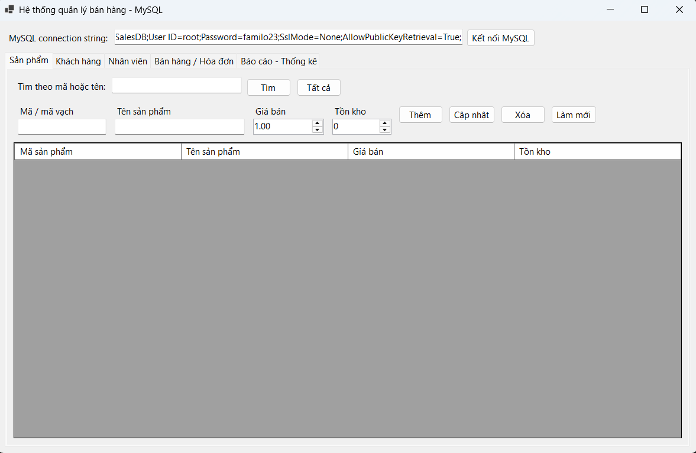
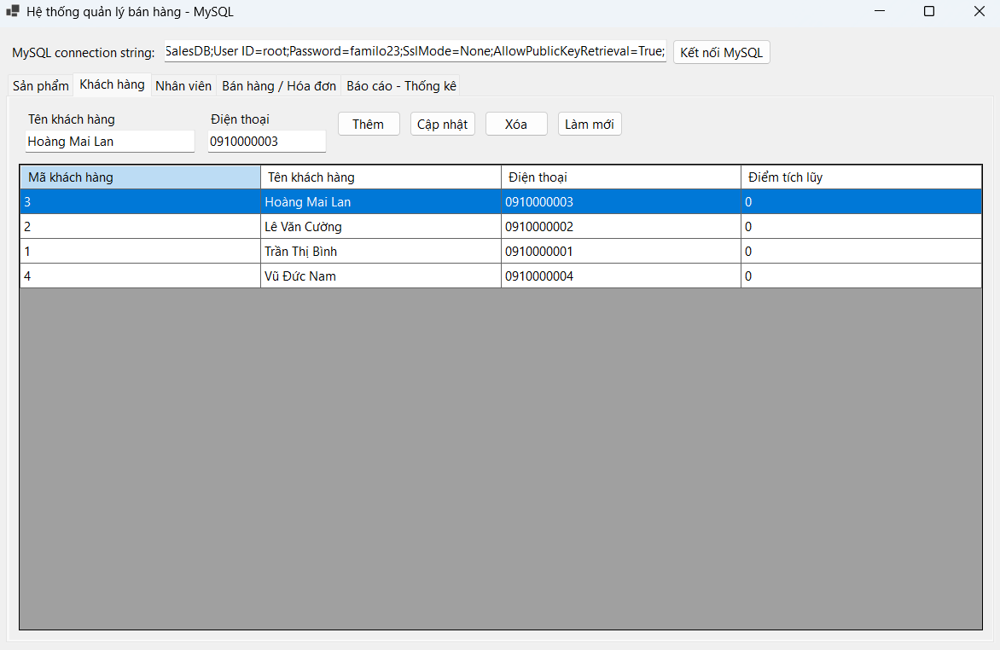
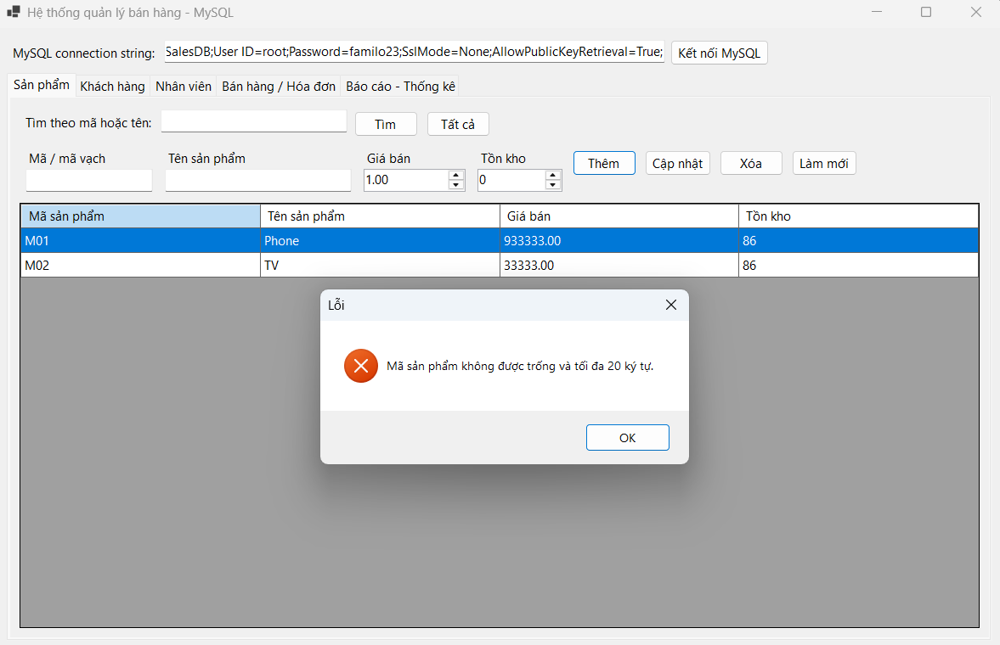
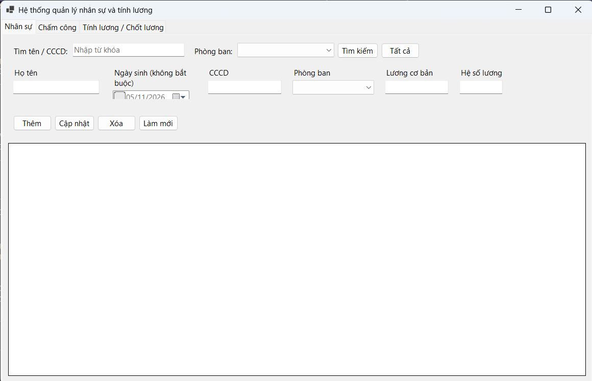
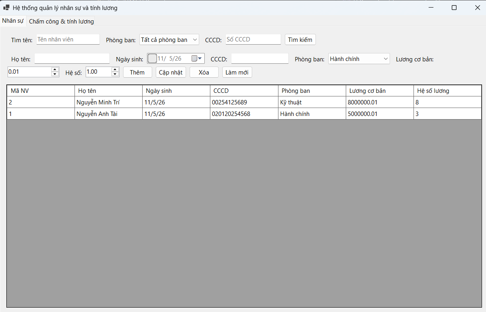
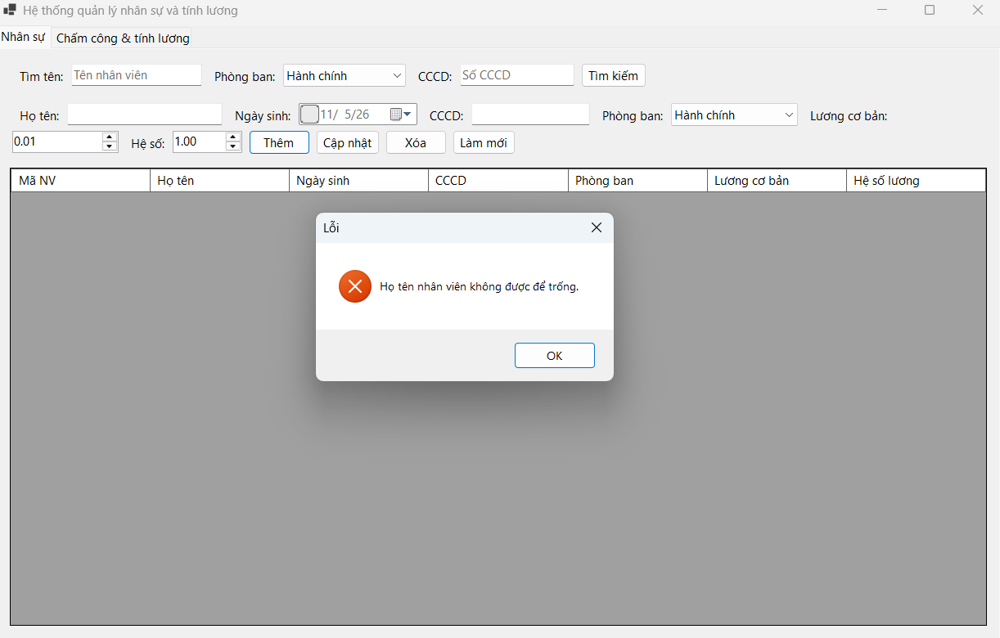

# BÁO CÁO BÀI TẬP 6.1 - 6.2

## I. THÔNG TIN SINH VIÊN
* **Họ và tên:** Nguyễn Minh Trí
* **Mã số sinh viên:** 24810320227
* **Lớp: D19QTANM1**
* **Lớp học phần:** Lập trình .NET 
* **Link Repository:** https://github.com/familo23/Baitap6.1-6.2/tree/main
---

## II. HƯỚNG DẪN CÀI ĐẶT & CHẠY DỰ ÁN

### 1. Yêu cầu môi trường
* Visual Studio có workload **.NET desktop development** và **.NET 10 SDK** (dự án dùng `net10.0-windows`, solution dạng `.slnx`).
* MySQL Server 8.x và MySQL Workbench (hoặc MySQL Shell).

| Bài | File script CSDL | Tên CSDL | File solution | Vị trí chuỗi kết nối |
|---|---|---|---|---|
| 6.1 | `Bai6.1/SalesDB.sql` | `SalesDB` | `Bai6.1/Bai6.1.slnx` | `Bai6.1/Bai6.1/Form1.cs` (dòng 10) |
| 6.2 | `Bai6.2/HRMDB.sql` | `HRMDB` | `Bai6.2/Bai6.2.slnx` | `Bai6.2/Bai6.2/Form1.cs` (dòng 71) |

### 2. Cài đặt với MySQL (cách dự án đang sử dụng)
1. Mở MySQL Workbench, kết nối tới MySQL Server trên máy (`localhost:3306`).
2. Chọn **File > Open SQL Script**, mở file script của bài cần chạy, sau đó bấm **Execute** (`Ctrl+Shift+Enter`) để khởi tạo CSDL.
3. Mở file `.slnx` tương ứng bằng Visual Studio.
4. Sửa chuỗi kết nối cho phù hợp với máy cá nhân, thay `<mat_khau>` bằng mật khẩu MySQL của bạn:
   * Bài 6.1: `Server=localhost;Database=SalesDB;User ID=root;Password=<mat_khau>;SslMode=None;AllowPublicKeyRetrieval=True;`
   * Bài 6.2: `Server=localhost;Port=3306;Database=HRMDB;CharSet=utf8mb4;Uid=root;Pwd=<mat_khau>;`

   Có thể đặt biến môi trường thay vì sửa code: `RETAIL_MYSQL_CONNECTION` (Bài 6.1), `HRMDB_CONNECTION_STRING` (Bài 6.2).
5. Build & Run dự án (`F5`). Với Bài 6.1, bấm nút **Kết nối MySQL** trên giao diện trước khi thao tác; chuỗi kết nối cũng có thể sửa trực tiếp trong ô nhập này.

### 3. Cài đặt với SQL Server Management Studio (SSMS)
> **Lưu ý:** Mã nguồn hiện kết nối bằng thư viện MySQL (`MySqlConnector`, `MySql.Data`) và hai file script viết theo cú pháp MySQL (`AUTO_INCREMENT`, `ENGINE=InnoDB`, `CREATE DATABASE IF NOT EXISTS`), nên **không chạy trực tiếp được trên SQL Server**. Cần chuyển đổi trước theo các bước sau.

1. Chuyển script sang T-SQL (`AUTO_INCREMENT` → `IDENTITY(1,1)`, bỏ `ENGINE=InnoDB` và `CHARACTER SET`, thêm `GO` sau `USE`), rồi mở SSMS và chạy script để khởi tạo CSDL.
2. Mở file `.slnx` bằng Visual Studio, thay gói NuGet MySQL bằng `Microsoft.Data.SqlClient`.
3. Trong tầng DAL, đổi `MySqlConnection`, `MySqlCommand`, `MySqlDataAdapter` sang `SqlConnection`, `SqlCommand`, `SqlDataAdapter`, đồng thời viết lại các câu lệnh riêng của MySQL (`ON DUPLICATE KEY UPDATE`, `FOR UPDATE`).
4. Sửa chuỗi kết nối, ví dụ: `Server=localhost;Database=SalesDB;Trusted_Connection=True;TrustServerCertificate=True;`
5. Build & Run dự án (`F5`).

------
## III.  KẾT QUẢ THỰC HÀNH

### Bài 6.1
### 1. Ảnh màn hình Giao diện chính

### 2. Ảnh màn hình kết quả

---------
.png)
---------
.png)
---------
.png)
---------
.png)
----
### 3. Ảnh màn hình Kiểm tra lỗi (Validation)

---
.png)

---
### Bài 6.2
### 1. Ảnh màn hình Giao diện chính

---

### 2. Ảnh màn hình kết quả

---------
.png)
---------
.png)
---------
.png)
---------
.png)
----

### 3. Ảnh màn hình Kiểm tra lỗi (Validation)

---

